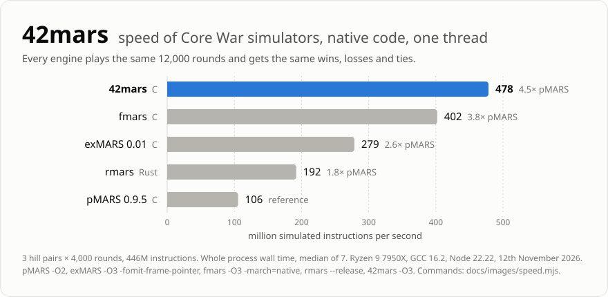
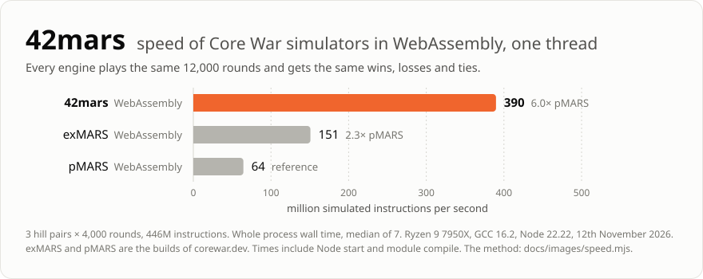
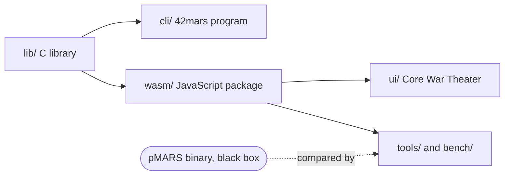

<p align="center">
  
</p>

<h1 align="center">42mars</h1>

<p align="center">
  A <a href="https://corewar.co.uk/">Core War</a> simulator (MARS) and Redcode assembler that give exactly the results of pMARS 0.9.5.<br>
  Fast, MIT licensed, in plain C11, with a WebAssembly build for Node and the browser.
</p>

<p align="center">
  <a href="https://github.com/martinus/42mars/actions/workflows/test.yml"></a>
  <a href="LICENSE"></a>
  
  
</p>

<p align="center">
  <a href="#why-42mars">Why 42mars</a> ·
  <a href="#compared-with-other-simulators">Comparison</a> ·
  <a href="#quick-start">Quick start</a> ·
  <a href="#written-in-a-clean-room-so-it-can-be-mit">Clean room</a> ·
  <a href="#repository-layout">Layout</a> ·
  <a href="docs/development.md">Development</a>
</p>

<p align="center">
  <picture>
    <source media="(prefers-color-scheme: dark)" srcset="docs/images/speed-dark.svg">
    
  </picture>
</p>

> [!NOTE]
> **Why the name?** I wrote [exMARS](https://corewar.co.uk/ankerl/exmars.htm) back in 2003. 42mars is my final MARS, and 42 is the answer to life, the universe and everything. So it had better be the answer to Core War simulation too.

## Why 42mars

- **Fast.** 478 million simulated instructions per second on one thread natively, 390 million in WebAssembly. That is 4.5 and 3.7 times pMARS 0.9.5 in [the benchmark above](#speed). Natively it is the fastest of the 8 builds I measured there. Rounds that can only end in a tie are stopped early, with an exact proof, so the scores stay the same.
- **The results of pMARS 0.9.5, quirks included.** Not only the same scores: the same instruction count and the same final core in every round. A differential test against a pMARS binary finds 0 differences in 9,600 battles, 567 hill warrior listings, 3,000 random sources and 1.8 million random expressions ([validation](docs/plan.md#validation)). CI runs it on every pull request against pMARS built from source: scores, listings and the output of `42mars`. The instruction count and core of every round need a patched pMARS and are compared locally.
- **The whole of Redcode.** `EQU`, `FOR`/`ROF`, `CURLINE`, registers `a` to `z`, `;assert`, `PIN`, p-space, ICWS'88 mode (`-8`), read and write limits, `-P` permutations. Also the weird stuff warriors depend on: `x equ 2+3` then `dat #x*2` gives `#8`, and a buffer bug in pMARS that turns `dat#9` at the end of a line into `dat #90`. 565 of 567 hill warriors assemble, and pMARS rejects the other 2 too.
- **MIT licensed.** Every other MARS I know of with pMARS's results is GPL. 42mars was [written in a clean room](#written-in-a-clean-room-so-it-can-be-mit) so that it can be MIT.
- **A C library that is easy to embed.** One header, [`lib/42mars.h`](lib/42mars.h), and one file to compile, [`lib/42mars.c`](lib/42mars.c). C11, no global state, no hidden allocation, no callbacks, so any language with a C FFI can call it. Builds with gcc, clang and MSVC; CI runs it on Linux (x64, arm64), macOS and Windows, and under ASan and UBSan.
- **Everywhere.** A command line program with pMARS's options and output, a JavaScript package (a 98 KB WebAssembly module, no dependencies), and Core War Theater, a WebGL2 visualizer that explains every instruction while it runs.

## Compared with other simulators

| | **42mars** | pMARS 0.9.5 | exMARS | fmars 0.0.207 | rmars |
|---|---|---|---|---|---|
| License | **MIT** | GPL | GPL | GPL | GPL-2.0 |
| Language | C11, WebAssembly | C | C | C, generated by Scheme code | Rust |
| Compilers | gcc, clang, MSVC | not checked | not checked | gcc or clang only (computed goto); code generation needs Guile 1.8 | Rust |
| Results | identical to pMARS 0.9.5: scores, instruction count and final core of every round | the reference | same scores on the benchmark rounds, and on 3,160 hill pairings (corewar.dev's build) | same scores on 3,160 hill pairings, no p-space | follows pMARS 0.9.6-dev: 46 of 3,160 hill pairings differ from 0.9.5, all with the same warrior |
| Assembler | all of pMARS 0.9.5, quirks included | the reference | pMARS's | rejects many hill warriors, so it got `pmars -A` output | its own |
| Speed, one thread, [million instructions/s](#speed) | **478** (C), **390** (WebAssembly) | 106 (C), 64 (WebAssembly) | 279 (C), 151 (WebAssembly) | 402 | 192 |
| Use from other code | C library: one header, no global state | program | C, with a Ruby interface | C, generated per instruction set | Python module |
| In the browser | WebAssembly module, no dependencies | corewar.dev's build | corewar.dev's build | not checked | not checked |

exMARS in C is release 0.01 from 2003, built with its own Makefile; the WebAssembly numbers of exMARS and pMARS are from the builds that [corewar.dev](https://corewar.dev/) runs. fmars is generated for the instruction words of a hill (109 here) and runs only warriors made of those. All rows come from my own runs on the [same 12,000 rounds](#speed) and on the 80 warriors of [this hill collection](https://github.com/n1LS/redcode-warriors), [details in the performance log](docs/performance-log.md).

## Speed

One thread, the 3 hill pairs of [`bench/bench.mjs`](bench/bench.mjs) with 4,000 rounds each, all engines with identical results. Whole process wall time, median of 7, Ryzen 9 7950X, 12th November 2026 ([commands](docs/images/speed.mjs)).

| Engine | Seconds | Million instructions/s |
|---|---|---|
| **42mars**, C | **0.932** | **478** |
| fmars 0.0.207 | 1.109 | 402 |
| **42mars**, WebAssembly | **1.144** | **390** |
| exMARS 0.01 | 1.600 | 279 |
| rmars | 2.321 | 192 |
| exMARS, corewar.dev's WebAssembly build | 2.957 | 151 |
| pMARS 0.9.5 | 4.225 | 106 |
| pMARS, corewar.dev's WebAssembly build | 6.917 | 64 |

<details>
<summary>WebAssembly chart</summary>

<p align="center">
  <picture>
    <source media="(prefers-color-scheme: dark)" srcset="docs/images/speed-wasm-dark.svg">
    
  </picture>
</p>

The times include starting Node and compiling the module, about 0.07 s per run.

</details>

<details>
<summary>Tournaments on all cores</summary>

80 hill warriors round robin, 100 rounds, 31 threads (10th November 2026): 42mars in WebAssembly 2.96 s, corewar.dev's exMARS 5.4 s, pMARS 10.8 s. fmars beats the WebAssembly build here, 2.88 s against 3.19 s (8th November 2026); 42mars natively takes 2.47 s. More in [`docs/plan.md`](docs/plan.md#speed) and [`docs/performance-log.md`](docs/performance-log.md).

</details>

Most of the speed comes from an 8-byte cell, a loop specialized for two warriors, separate code for the 32 most executed instruction words, and exact early ties.

## Quick start

### C library

Compile `lib/42mars.c` together with your program. Nothing else is needed:

```sh
cc -O2 -Ilib -o example examples/example.c lib/42mars.c
./example -r 100 warriors/imp.red warriors/dwarf.red    # wins losses ties, one line per warrior
```

A whole match in a few lines, without error handling:

```c
#include <stdio.h>
#include <string.h>
#include "42mars.h"

int main(void) {
  const char *imp = ";name Imp\nmov 0, 1\n";
  const char *dwarf = ";name Dwarf\nadd #4, 3\nmov 2, @2\njmp -2\ndat #0, #0\n";
  m42_rules rules = m42_rules_94(); // pMARS's defaults: core 8000, 80000 cycles, ...
  m42_warrior *w[2] = {
    m42_assemble_new(imp, strlen(imp), &rules, 0, NULL, NULL),
    m42_assemble_new(dwarf, strlen(dwarf), &rules, 0, NULL, NULL),
  };
  m42_ctx *m = m42_new(&rules, NULL);
  m42_match_options o = m42_match_options_default();
  o.rounds = 100;
  o.seed = 1;
  m42_score s[2];
  m42_match(m, (const m42_warrior *const *)w, 2, &o, s, NULL);
  for (int i = 0; i < 2; ++i) printf("%u %u %u\n", s[i].wins, s[i].losses, s[i].ties);
  m42_free(m);
  m42_warrior_free(w[0]);
  m42_warrior_free(w[1]);
}
```

[`examples/example.c`](examples/example.c) is the complete program, [`lib/42mars.h`](lib/42mars.h) documents every function. To build and install the static and the shared library, the `42mars` program and a pkg-config file:

```sh
make                    # into build/
make test               # the C tests, needs Node 20 or newer
sudo make install       # into /usr/local, or make install PREFIX=...; on Linux, sudo ldconfig after the first install
cc -O2 -o my-program my-program.c $(pkg-config --cflags --libs 42mars)
```

> [!TIP]
> On Windows, `build-msvc.bat` builds the same with MSVC, or compile directly: `cl /O2 /std:c11 /Ilib examples\example.c lib\42mars.c`. Every [release](https://github.com/martinus/42mars/releases) has these builds for Linux (x64, arm64), macOS (arm64) and Windows (x64).

### Command line

`42mars` takes pMARS's options and prints pMARS's output, so tools that call pMARS can call it instead (differences: [`docs/redcode-semantics.md`](docs/redcode-semantics.md), section 5):

```sh
make
build/42mars -b -r 100 warriors/imp.red warriors/dwarf.red
build/42mars -b -k -r 1000 -P a.red b.red       # KotH output, all permutations
```

### JavaScript and WebAssembly

The JavaScript package is the WebAssembly build with its JS interface and TypeScript types, for Node 20 or newer and the browser, without a bundler. It is not on npm; each [release](https://github.com/martinus/42mars/releases) has it as `42mars-<version>.tgz`:

```sh
npm install https://github.com/martinus/42mars/releases/download/v1.0.0/42mars-1.0.0.tgz
```

```js
import { assemble, createMars } from '42mars';

const mars = await createMars(); // compiles the module, so that assemble() works in a browser too
const imp = assemble(';name Imp\nmov 0, 1\n');
const dwarf = assemble(';name Dwarf\nadd #4, 3\nmov 2, @2\njmp -2\ndat #0, #0\n');
const { warriors } = mars.runMatch([imp, dwarf], { rounds: 100, seed: 1 });
for (const w of warriors) console.log(w.name, w.wins, w.losses, w.ties);
```

In a browser: `import { ... } from 'https://cdn.jsdelivr.net/gh/martinus/42mars@v1.0.0/wasm/42mars.js'`. The types are in [`wasm/42mars.d.ts`](wasm/42mars.d.ts).

### Core War Theater, the visualizer

```sh
npm run serve           # then open http://127.0.0.1:8000/ui/
```

New to Core War? Press `?` for a short guide, then **learn**: every instruction gets explained in plain English while it runs. The rules `nano · 80` show the instruction text inside the cells. Drop `.red` files onto the page to load them.

<details>
<summary>Keys and URL parameters</summary>

| Key | Does |
|---|---|
| `Space` | play, pause |
| `→`, `Shift+→` | 1 step, 100 steps |
| `N`, `R` | next round, restart |
| `L` | ring or grid layout |
| `F` | footprints: which cells a warrior read or only incremented this round |
| `[` `]` | slower, faster |
| `?` | guide |

URL parameters: `?cast=lantern,origami,seeker` picks sample warriors, `preset=nano`, `layout=grid`, `speed=0..16`, `steps=N` (run N instructions, then pause), `rounds=N`, `paused`, `noguide`.

</details>

## Written in a clean room, so it can be MIT

MIT matters for a library that is meant to be embedded. With a GPL MARS, every evolver, hill server, game or web app that links it or bundles its WebAssembly module has to be GPL too. With MIT you can copy `lib/42mars.c` into any project, open or closed, under any license. The price: nobody has to give improvements back.

pMARS, exMARS, exhaust, fmars, rmars and the engines of corewar.dev are all GPL. Code that derives from any of them is GPL too, so to get a MIT licensed MARS with pMARS's results nobody who writes 42mars code may read theirs. 42mars was written by AI agents under that rule:

1. The behavior is written down as prose, no code: [`docs/redcode-semantics.md`](docs/redcode-semantics.md). It covers the evaluation order, the queue order of `SPL`, the cycle count after a death, the start positions from pMARS's random generator, every assembler quirk.
2. pMARS is used only as a program: the agents run it on warriors they wrote themselves and compare its output with ours ([`tools/pmars-diff.mjs`](tools/pmars-diff.mjs), [`tools/expr-fuzz.mjs`](tools/expr-fuzz.mjs)). Its source is never opened.
3. Ideas from other simulators reached the engine only as descriptions in prose, written by separate sessions that wrote no engine code ([the list](docs/performance-log.md#ideas-from-other-simulators)).
4. The rule is in [`CLAUDE.md`](CLAUDE.md), and a hook, [`.claude/hooks/clean-room.mjs`](.claude/hooks/clean-room.mjs), refuses tool calls that would show source of another MARS.

## Repository layout

```
lib/                the C library, the only thing you need to embed
├── 42mars.h        the public interface
├── 42mars.c        the one file to compile; includes src/
├── 42mars.def      the exports of the Windows DLL
└── src/            mars.c simulator, asm.c assembler, api.c, platform.h compiler specifics,
                    dispatch.h generated by gen-dispatch.mjs
cli/42mars.c        the pMARS-compatible command line program
examples/           example.c, a complete program on the library
wasm/               the JavaScript package: 42mars.wasm, 42mars.js (JS interface), 42mars.d.ts; build.sh
ui/                 Core War Theater, the visualizer (plain ES modules, no build step)
tools/              Node tools: asm, corpus, tournament, serve, and the comparisons with pMARS
bench/              speed measurements and A/B timing
test/               npm test: 386 tests on node:test; C tests in test/c/, fuzz targets in test/fuzz/, recorded results in test/fixtures/
docs/               the semantics, the plan, the performance log, development guide
warriors/           sample warriors written for this repository, and Dewdney's Imp and Dwarf;
                    koenigstuhl/: 5,261 hill warriors, test material without a license
Makefile            native build on Linux and macOS; build-msvc.bat for Windows
CHANGELOG.md        the changes of the interface, from 1.0.0 on
```



[`docs/development.md`](docs/development.md) explains how to build, test, compare with pMARS and measure speed. [`docs/plan.md`](docs/plan.md) has the design, the validation and the roadmap, [`docs/redcode-semantics.md`](docs/redcode-semantics.md) the exact behavior of assembler and simulator.

## License

MIT, see [LICENSE](LICENSE). The sample warriors in [`warriors/`](warriors) are MIT too, except Imp and Dwarf, the classic examples from A. K. Dewdney's 1984 article. The hill warriors in [`warriors/koenigstuhl/`](warriors/koenigstuhl) have no license and are not covered by it: they are test material, downloaded from the [Koenigstuhl](https://asdflkj.net/COREWAR/koenigstuhl.html) hills on 12th November 2026.
