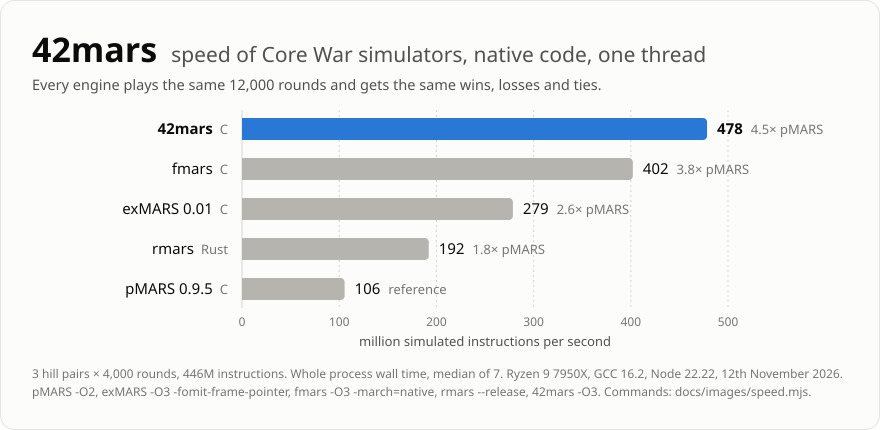
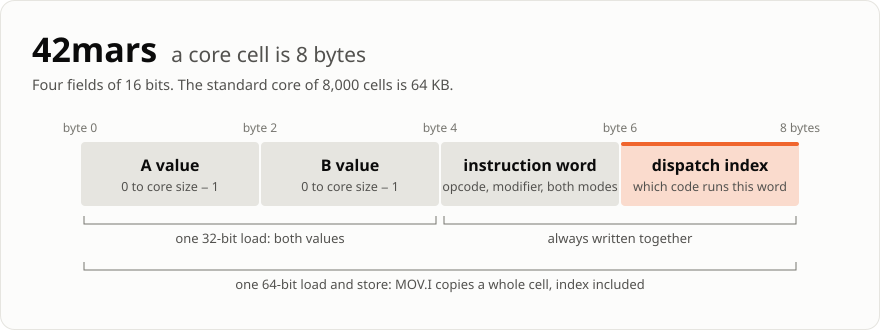
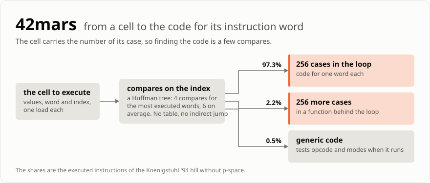
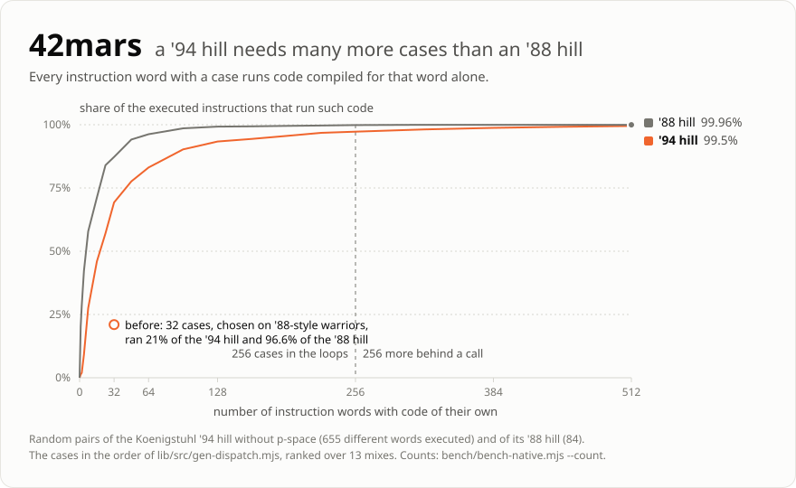
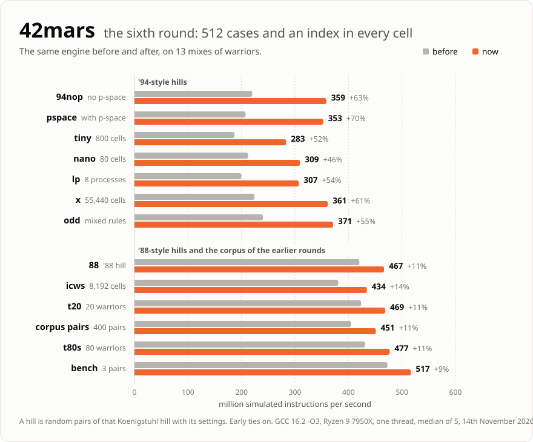

# Where the speed of 42mars comes from

42mars simulates 405 million instructions per second on one thread with '94 hill warriors, and 527 million with '88-style ones. That is 4.0 and 5.0 times pMARS 0.9.5, with the same result in every round. This page explains the tricks behind these numbers, one section each. Every experiment, also the ones that failed, is in [`performance-log.md`](performance-log.md) with its commands.

<p align="center">
  <picture>
    <source media="(prefers-color-scheme: dark)" srcset="images/speed-dark.svg">
    
  </picture>
</p>

All numbers are from an AMD Ryzen 9 7950X with GCC 16.2 and clang 22.1, one thread on a core with a fixed frequency, the library as `make` builds it (`-O3`, no `-march`).

| Trick | What it saves | Measured |
|---|---|---|
| [A cell is 8 bytes](#a-core-cell-is-8-bytes) | memory traffic: `MOV.I` is one load and one store | from the first version |
| [Code for one instruction word](#every-frequent-instruction-word-has-its-own-code) | the tests of opcode, modifier and modes | 83 → 53 x86 instructions per simulated one |
| [The index in the cell](#the-cell-carries-the-number-of-its-code) | the search for that code | 11 to 28% against a jump table |
| [512 words](#512-words-because-94-warriors-use-so-many) | generic code on '94 hills | '94 hills +46 to +70% |
| [A loop for two warriors](#two-warriors-have-a-loop-of-their-own) | queue wraparound, 2 of 5 counters | +7% natively, +4 to +7% more in WebAssembly |
| [Early ties](#rounds-that-can-only-end-in-a-tie-stop-early) | instructions that cannot change the score | 4 to 13% of all instructions |

## A core cell is 8 bytes

<p align="center">
  <picture>
    <source media="(prefers-color-scheme: dark)" srcset="images/cell-dark.svg">
    
  </picture>
</p>

The core is an array of cells with four 16-bit fields. The instruction word packs opcode, modifier and both addressing modes into 14 bits. The standard core of 8,000 cells is 64 KB: twice the L1 data cache of this CPU, a sixteenth of its L2 cache.

The layout decides what the common instructions cost:

- `MOV.I` is one 64-bit load and one 64-bit store. It is 35% of all executed instructions.
- Both values of a cell are one 32-bit load, e.g. for `ADD.F`.
- `CMP.F` compares both values of two cells with one 32-bit compare.

## Every frequent instruction word has its own code

There is one function that executes an instruction, [`exec_ins()`](../lib/src/mars.c). It gets the instruction word as a parameter and tests its modes and its opcode, like any interpreter. The trick is to call it with a constant:

```c
// generic: the word comes from the cell
return exec_ins(m, core, ..., ir, ir.ins);

// specialized: the compiler knows the word
return exec_ins(m, core, ..., ir, 7430); // mov.i * <
```

`exec_ins()` is always inlined. With a constant word the compiler removes every test of mode, modifier and opcode, and what is left is straight code for `mov.i * <` alone. [`gen-dispatch.mjs`](../lib/src/gen-dispatch.mjs) generates one such call for each of the 512 most executed words.

Nothing is written twice, so the 512 copies cannot drift apart from the generic code. A test runs every one of them against it anyway.

When this came in, with 32 words, a simulated instruction of a 20-warrior tournament went from 83 to 53 x86 instructions and from 18.9 to 13.5 cycles. Today it takes 41 x86 instructions and 10.5 cycles.

## The cell carries the number of its code

Now the engine has to find the code for a word, and the search must not cost what the specialization saved. Two obvious ways were slower:

- **A jump table.** All words then share one indirect jump, and the branch predictor has to guess its target from history alone. It was 11 to 28% slower than what is in the code now, and branch misses per simulated instruction went from 0.07 to 0.14 when I tried it first.
- **Compares on the word itself.** The words with a case are scattered over 14 bits, so every leaf needs a test for equality on top of the range tests. It was 3% faster on one mix and 4 to 6% slower on another.

So every cell carries a second number next to its word: the dispatch index, the position of the word's code among all cases. `step()` finds the code with a tree of compares on that index. Each compare is a conditional branch with its own history in the predictor, and no leaf needs an equality test because every index is a leaf.

<p align="center">
  <picture>
    <source media="(prefers-color-scheme: dark)" srcset="images/dispatch-dark.svg">
    
  </picture>
</p>

The tree is a Huffman tree over the measured share of each word. The most executed words are 4 compares from the root, the average is 6.

Keeping the index right is cheap, because a word gets into a cell in three ways only. Loading a warrior and clearing the core compute it. `MOV.I` copies the whole cell, so the index travels with the word for free. No other instruction writes a word.

## 512 words, because '94 warriors use so many

<p align="center">
  <picture>
    <source media="(prefers-color-scheme: dark)" srcset="images/words-dark.svg">
    
  </picture>
</p>

An '88 hill executes 84 different instruction words, a '94 hill 655: the '94 rules added modifiers and addressing modes, and the warriors use them. Until the sixth round of speed work I measured only on '88-style warriors, and 32 words were enough there. On the '94 hill these 32 words covered 21% of the instructions. The other 79% ran the generic code, at 220 million instructions per second instead of 420 million. A code review found that, not a benchmark.

Now the words are ranked over 13 mixes of warriors, 9 of them [Koenigstuhl](../warriors/koenigstuhl/README.md) hills, and 512 of them have a case:

- **256 in the instruction loops.** More made clang slower: with 384 it lost 4 to 6% on the '88-style mixes and on two of the '94 hills.
- **256 more in one function behind the loops**, which also holds the generic code. A call is cheaper than the generic code: 1 to 4% on the '94 hills.

<p align="center">
  <picture>
    <source media="(prefers-color-scheme: dark)" srcset="images/hills-dark.svg">
    
  </picture>
</p>

With clang the '94 hills gain 32 to 58% and the '88-style mixes 6 to 14%. The lesson is in the chart: the inputs decide what you find.

## Two warriors have a loop of their own

Nearly every hill battle is one warrior against one. [`execute2()`](../lib/src/mars.c) is the instruction loop for exactly that case:

- **Linear queues.** Each process queue is long enough for a whole round, so no queue index ever wraps and none needs a mask.
- **One head for both queues.** Each warrior takes one process off its queue per turn, so both heads move in step. The loop keeps one head and two tails in registers instead of two heads, two tails and a cycle counter. The head counts the cycles too.
- **A pair of turns per pass.** The body is warrior 0's turn followed by warrior 1's, with no test for whose turn it is.
- **The standard settings as constants.** A second copy of the loop has the core size 8,000 and the process limit 8,000 compiled in, so the wraparound tests compare with immediates.

The loop was worth 7% natively when it came in. The one head added 4 to 7% in WebAssembly, where registers are scarce. Natively it did not help.

## Rounds that can only end in a tie stop early

Many rounds run to the cycle limit with both warriors alive. Two proofs stop such a round as soon as its result is certain. Both are exact: the scores are those of the full simulation.

1. **Too many processes to die.** A warrior loses at most one process per turn. When every warrior has more processes than turns left, nobody can die anymore.
2. **Nothing left that kills.** Only `DAT` kills a process, and `DIV` or `MOD` by zero. Instructions are only copied, never invented, so a core without such a cell stays without one. Papers and imp spirals get there once they wrote over the whole core.

The second proof needs to know whether the core still has a `DAT`. Counting them on every write made each instruction 5.5% slower. A scan every 4,096 instructions at most, starting at the last `DAT` it found, costs nothing in the loop.

| Mix | Instructions skipped |
|---|---|
| '88 hill | 12.6% |
| 20-warrior tournament, '88-style | 9.7% |
| tiny hill | 6.0% |
| '94 hill | 4.2% |

A paper against an imp spiral gains the most: `acme.red` against `alpha.red` went from 51 to 13 ms for 100 rounds.

## Smaller things

- **The fields of the instruction are loaded one by one**, not as one 64-bit load that is taken apart. A 16-bit load can take its data from a 16-bit store that is still on its way, the 64-bit load has to wait for it: 2 to 5%.
- **B values are read only by the instructions that need them.** `JMP` and `SPL` never do.
- **The warrior record is 128 bytes**, so indexing it is a shift.
- **No allocation and no global state.** A context is caller memory. Starting a round, with clearing the core and placing the warriors, is 0.3% of the time.
- **Tournaments use all cores.** Battles are independent, so [`tools/tournament.mjs`](../tools/tournament.mjs) and [`examples/parallel.c`](../examples/parallel.c) run one per thread. 3,160 pairings of 80 warriors with 100 rounds each take 2.4 s on this 16-core machine.

## What did not work

Every idea below looked good and was built. The numbers are against the code of its day.

| Idea | Result |
|---|---|
| A case for each of the 8,512 instruction words | natively 40% slower and 14 to 26 minutes of compile time; 8 times slower in WebAssembly, where V8 gave up optimizing the loop |
| A jump table on the dispatch index | 11 to 28% slower: one indirect jump for all words |
| Threaded code, a handler per word that tail-calls the next | natively 14% slower, in WebAssembly less than half the speed |
| Two battles interleaved in one loop | 17% slower: 18% more x86 instructions, and the two battles share the branch predictor's history |
| More than 256 cases in the loops | gcc 1 to 3% faster, clang 4 to 6% slower on half of the mixes |
| A third tie proof, for warriors trapped in a loop | 190 lines; up to 1.9% faster on two mixes, up to 0.3% slower on two others: removed |
| Profile-guided optimization | 4 to 7% faster natively, not used: everybody who compiles the library would need the profile |

## How it is measured

- Two builds of the library run alternately on the same input, each run in a fresh process. `bench/ab-native.mjs` does that.
- Every run is pinned to one core with a fixed frequency. The range of 3 runs is within 0.3% then.
- Both gcc and clang. A change that looked neutral in C moved one of them by 2 to 5% more than once.
- 13 inputs, '94 hills first. Both builds must execute exactly the same number of instructions on each.
- A number is compared only with a number of the same session. The same build ran 15% apart in two sessions.

## What it costs

Speed is not free here. The library compiles in 7.8 s with gcc instead of 2.6 s, and its object file grew from 186 to 399 KB. The WebAssembly module went from 101 to 288 KB, and it lost 7.5% on a 60 ms benchmark of '88-style warriors, because V8 now needs 17 ms instead of 8 to compile the loop. MSVC gets 16 cases instead of 512, since it took 2 minutes for 32, so on Windows the '94 hills run mostly generic code. I have not measured how fast that is.
